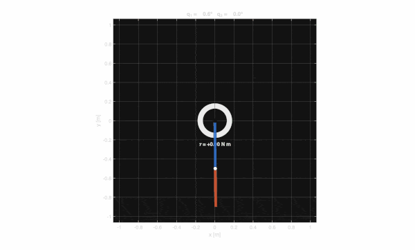

# pendubot-simulink

Simulink simulation of a **Pendubot**: a planar two-link pendulum with an actuated base joint (`q1`, driven by a torque `tau`) and a passive elbow joint (`q2`). The controller swings the pendulum up from the hanging position with **energy pumping** and then **balances it upside down with LQR**. It can also bring the pendulum back down and stop it.

The model is sized for a realistic wall-mounted DIY build (1.8 m overall diameter) driven by a compact quasi-direct-drive actuator. Torque limits, encoder quantization and velocity estimation are modeled, so what you see in simulation is a reasonable preview of the real hardware.



---

## Quick start

1. Open MATLAB and `cd` into the repository folder.
2. Open the Simulink model (`pendubot.slx`).
3. Press **Run**.

That's it. The model's `InitFcn` callback runs `params_pendolo.m` automatically, so all parameters, the LQR gain and the encoder settings are loaded before every run. The `StartFcn` callback runs `clear drawPendulum`, which resets the animation state. A figure window shows the pendulum while the simulation runs. A circular gauge around the base joint shows the applied torque: the sector grows counter-clockwise for positive torque and clockwise for negative torque, and turns from green to red as it approaches full scale.

To record the animation as a GIF, set `recordGif = true` at the top of `drawPendulum.m`. The file is written to `docs/animation.gif`. Compress it before committing (e.g. `gifsicle -O3 --colors 64 --resize-width 600 --lossy=60`).

To switch between the **upright** and **hanging** targets during a run, double-click the *Manual Switch* that feeds the `target` input of the controller (1 = up, 0 = down).

> Tip: enable *Run → Simulation Pacing* to watch the animation in real time.

## Requirements

| Product | Needed for |
|---|---|
| MATLAB + Simulink | everything |
| **Control System Toolbox** | **required**: `lqr()` is called in `params_pendolo.m` to compute the balancing gain `K` and the Riccati matrix `P`. The simulation cannot start without it. |
| Symbolic Math Toolbox | optional, only for `derive_pendolo.m` (symbolic derivation of the model) |

---

## Conventions

- `q1`: absolute angle of link 1, measured from the **downward vertical**, counter-clockwise positive.
- `q2`: angle of link 2 **relative to link 1**.
- State: `x = [q1; q2; dq1; dq2]`.
- Hanging equilibrium: `q1 = 0, q2 = 0`. Upright target: `q1 = pi, q2 = 0`.
- Potential energy is zero at the base joint, with the y axis pointing up. The upright rest energy is `Etop = (m1*lc1 + m2*(L1 + lc2))*g`.

## Model structure

```
target ──► [control] ──tau──► [dinamica] ──xdot──► [Integrator] ──x──┬──► [animazione]
              ▲                    ▲                                 │
              │                    └──────────── x ──────────────────┤
              └──────── xm ◄── [encoder] ◄───────────────────────────┘
```

| Block / file | Role |
|---|---|
| `dinamica` (MATLAB Function) | Nonlinear dynamics `M(q)·ddq + C(q,dq) + G(q) + F(dq) = [tau; 0]`. Outputs `xdot` and the total energy `E` (for diagnostics). This is the "physical pendulum". |
| Integrator | Integrates `xdot`, initial condition `x0`. |
| `encoder` (MATLAB Function, Ts = 1 ms) | Quantized encoder readings and velocity estimation (finite difference + first-order low-pass filter). The controller only sees this **measured** state. |
| `control` (MATLAB Function, Ts = 1 ms) | Swing-up, balancing and descent logic (see below). |
| `animazione` (MATLAB Function) + `drawPendulum.m` | Live animation with torque gauge and optional GIF recording. Graphics run as an extrinsic MATLAB function. Inputs: `q1, q2, L1, W1, L2, W2, tau, tauMax`. |
| `params_pendolo.m` | Physical parameters, LQR design, controller and encoder settings. |
| `derive_pendolo.m` | Symbolic derivation of energy, `M`, `C`, `G` and the linearization from the geometry alone. Generates `pend_*.m` functions. Useful to validate or extend the model. |

The plant (`dinamica`) and the controller (`control`) intentionally compute the energy **independently**. The controller works only from measured angles and its own model parameters, as it would on real hardware. This makes it easy to test model mismatch: give the controller a parameter vector that differs from the plant's.

---

## Control strategy

### 1. Swing-up: energy pumping
Away from the upright position, the controller regulates the total mechanical energy `E` to the upright rest energy `Etop`:

```
tau = sat( kE * (Etop - E) * dq1 ,  ±tau_sw )
```

Since `dE/dt = dq1 * tau` (minus friction), this law always pushes in the direction of motion while `E < Etop` and brakes when `E > Etop`. The swing-up torque limit `tau_sw` is deliberately set **below** the static torque needed to hold the links horizontal. The motor therefore cannot lift the pendulum directly: it has to pump energy over several swings, like a child on a swing.

### 2. Balancing: LQR
The model is linearized about `[pi, 0, 0, 0]` and an LQR gain is computed with `Q = diag(10, 10, 1, 1)`, `R = 1`:

```
tau = sat( -K * e ,  ±tau_lqr ),   e = [wrap(q1 - pi); wrap(q2); dq1; dq2]
```

### 3. Switching
The controller switches to LQR when the state enters the estimated region of attraction, measured by the LQR cost-to-go `V = e'·P·e < Vin`. It falls back to swing-up when `V > Vout`. The hysteresis prevents chattering at the boundary.

### 4. Descent
With `target = 0` the LQR is disabled and a saturated PD on `q1` brings the pendulum down and damps it. Pure energy removal is not used here: with a large energy error it acts as a stiff brake on joint 1 and traps the energy in the spinning second link.

---

## Reference hardware

| Item | Value |
|---|---|
| Link lengths | `L1 = 0.50 m`, `L2 = 0.40 m` (1.8 m overall diameter) |
| Links | aluminium square tube 30×30 mm or hardwood 30×30 mm, conservative linear mass 0.7–0.9 kg/m |
| Elbow mass | 0.15 kg (bearing, hub, encoder) |
| Actuator | CubeMars **AK80-6** (6:1 planetary QDD, 6 N·m rated / 12 N·m peak, integrated driver and 14-bit encoder, CAN) |
| Elbow encoder | 14-bit magnetic encoder (e.g. AS5047P) |
| Control rate | 1 kHz |

Static torque to hold link 1 horizontal (link 2 hanging) is about 3–3.6 N·m depending on link mass. The swing-up limit is 2 N·m. Balancing may use the actuator peak (12 N·m), but in steady state the torque stays close to zero.

## Tuning parameters (`params_pendolo.m`)

| Parameter | Default | Meaning |
|---|---|---|
| `kE` | 5 | energy pumping gain |
| `tau_sw` | 2 N·m | torque limit during swing-up |
| `tau_lqr` | 12 N·m | torque limit during balancing (actuator peak) |
| `Vin`, `Vout` | 20, 60 | LQR switching thresholds on `e'·P·e` |
| `kp_dn`, `kd_dn` | 2, 1 | PD gains for the descent |
| `fc_vel` | 30 Hz | velocity filter cutoff |
| `Q`, `R` | `diag(10,10,1,1)`, 1 | LQR weights |

## Validation checks

- **Energy conservation**: with `tau = 0` and zero friction, `E` must stay constant (variations of the order of solver tolerance).
- **Dissipation**: with friction, `E` must decrease monotonically and the pendulum must settle hanging.
- **Robustness**: swing-up and capture keep working with ±20 % mass variations, severe torque saturation, encoder quantization and random initial states.

## Known limitations and ideas

- No CAN latency or dropped frames yet (add a *Unit Delay* between `encoder` and `control`).
- No gearbox backlash or Coulomb friction.
- An encoder zero offset produces a bent equilibrium (about 5.5° of link 1 tilt per 1° of `q2` offset), because the Pendubot has a continuum of equilibria with link 2 vertical. Integral action would remove it.
- Motor electrical dynamics are not modeled. The driver's current loop is assumed much faster than the mechanics.

## Hardware safety notes

A 1.8 m pendulum spinning at several hundred rpm is dangerous. If you build it: keep a clear radius, add a hardware emergency stop that cuts motor power, add a watchdog that zeroes the torque on control-loop or CAN timeouts, use a slip ring for the elbow encoder wiring, and plan for regenerative braking energy on the supply bus.

---

## References

- M. W. Spong, D. J. Block, *The Pendubot: a mechatronic system for control research and education*, Proc. 34th IEEE Conference on Decision and Control, 1995.
- K. J. Åström, K. Furuta, *Swinging up a pendulum by energy control*, Automatica, 36(2), 2000.
- I. Fantoni, R. Lozano, M. W. Spong, *Energy based control of the Pendubot*, IEEE Transactions on Automatic Control, 45(4), 2000.
- F. Wiebe et al., *Open Source Dual-Purpose Acrobot and Pendubot Platform: Benchmarking Control Algorithms for Underactuated Robotics*, IEEE Robotics and Automation Magazine, 31(2), 2024.

## License

Released into the public domain under [The Unlicense](LICENSE). Do whatever you want with it.
